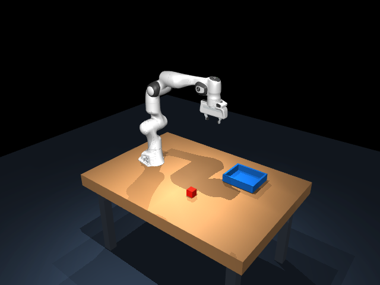

# SmolVLA Panda Pick and Place

使用 SmolVLA 在 MuJoCo 中控制 Franka Panda，自主完成红色方块的抓取、搬运、放置与释放。

本项目包含任务适配、四阶段微调、模型选择、闭环执行及 200 次配对实验。仓库提供代码、仿真资源、训练记录和结果证据。大模型权重与完整示教图像另行保存。



[查看成功抓放视频](assets/demo-success.mp4) · [复现说明](docs/reproduction.md) · [实验过程](docs/experiments.md) · [问题与改进](docs/limitations.md) · [结果 CSV](results/summary.csv)

## 已完成的结果

最终选用累计 **33,000 次优化器更新**的微调模型。在冻结的新位置上，四组各 50 次，共 200 次正式实验：

- 微调模型，正常灯光：**45/50，90%**，成功任务平均 **27.98 仿真秒**。
- 微调模型，灯光强度 90%：**46/50，92%**，成功任务平均 **27.99 仿真秒**。
- Base，正常灯光：**0/50**。
- Base，灯光强度 90%：**0/50**。

每组使用相同的 40 个内部位置和 10 个边界位置。因此是 **50 个唯一位置、200 个条件组合**。正常光下内部位置 38/40，边界位置 7/10。小幅降光的差异只有一次成功，不能据此认定降光改善模型。

完整成功要求：真实抓取并抬升，搬运至托盘，松爪、脱离机器人接触，并在托盘内独立稳定至少 2 秒，全程不超过 30 仿真秒。开发选模的 50/50 和 47/50 不计入上述正式成绩。

## 模型输入与执行

- 输入：固定相机 RGB、7 个实测关节角度、归一化夹爪开度，以及固定英文任务指令。
- 指令：`Pick up the red cube and place it in the tray.`
- 输出：7 维关节绝对位置目标和 1 维归一化夹爪目标。
- 最终配置：50 个动作目标，目标间隔 100 ms，覆盖约 5 秒。执行前 1 仿真秒后重新观察。
- 底层执行：50 Hz 控制，500 Hz 物理积分，相邻预测目标之间插值。

物块的数值位姿、接触力和阶段标签不作为策略输入。阶段标签只用于离线选择训练锚点，物理指标用于保护和结果评估。同步推理期间仿真暂停，本项目尚未证明真实时间部署性能。

## 数据与训练

100 条成功专家轨迹，共 136,589 帧，记录频率 50 Hz。固定划分为 Train80 和 Validation20，每条训练轨迹使用 256 个锚点，共 20,480 个锚点条目。锚点会重复参与训练，训练步数不等于独立锚点数量。

最终权重的训练谱系：

1. **0 至 20k**：建立初始任务基线，闭环开发验证 0/5。
2. **20k 至 22k**：固定裁剪工作区，适配部分视觉与文本模块，抓取和抬升仍不稳定。
3. **22k 至 27k**：将动作目标间隔从 20 ms 改为 100 ms。小样本验证达到 4/5，但扩展开发评估仅 32/50。
4. **27k 至 33k**：加强支撑、释放和撤离采样，降低学习率，并进行更充分的开发验证后选模。

各阶段目标时域和采样设置发生过变化，训练损失不能直接跨阶段比较。正式测试完成后补做的最终离线验证损失为约 0.003315，只作记录，不参与事后选模。

## 快速查看

不需要 GPU、权重或训练数据，即可核验现有结果：

```bash
python scripts/summarize_results.py --check
python scripts/verify_release.py
python run_task.py --help
```

运行仿真需要原项目所用的 Python / MuJoCo 依赖。Linux 或 WSL2 中，在仓库根目录运行：

```bash
python scripts/check_environment.py --preview
python scripts/expert_demo.py --label expert-demo
```

`expert-demo` 是专家控制器演示，**不属于 SmolVLA 成绩**。纯模型演示需要另行提供最终权重：

```bash
export TASK4_MODEL=/absolute/path/to/033000/pretrained_model
python run_task.py rollout --model selected --episode 32 --label model-demo
```

不要把最后一条命令的单次演示当作独立正式评估。训练、模型准备和环境边界见[完整复现说明](docs/reproduction.md)。

## 仓库内容

```text
smolvla_task/       训练、采样、模型加载、动作块执行与原实验支持模块
simulation/        Panda 场景、原生物理环境和专家控制组件
assets/            成功视频、场景预览和小型 VLM 配置
model_bundle/      最终模型配置、tokenizer 和归一化参数，不含大权重
data_metadata/     Train80/Validation20、训练统计和封存采样锚点
records/           训练日志、选模证据、离线验证和失败诊断
results/           200 次逐条结果、执行协议、汇总 CSV 和 JSON
scripts/           环境核验、结果复核和演示入口
docs/              复现、实验过程、限制和发布副本变更说明
```

此版本从课程实验封存内容整理，修正了运行路径并拆出了必要的仿真依赖。原实验文件和权重保持不变，详见[整理范围](docs/publication-notes.md)。代码验证覆盖范围见该文件中的本地核验记录。

## 依赖与引用

项目基于 [LeRobot / SmolVLA](https://github.com/huggingface/lerobot)、[MuJoCo](https://github.com/google-deepmind/mujoco) 和 [MuJoCo Menagerie Panda](https://github.com/google-deepmind/mujoco_menagerie/tree/main/franka_emika_panda)。第三方仿真资产保留原有 Apache-2.0 许可证及修改说明，见 [THIRD_PARTY_NOTICES.md](THIRD_PARTY_NOTICES.md)。

本仓库目前为私有课程项目。仓库可见性不替代代码授权，未额外为作者代码指定开源许可证。
